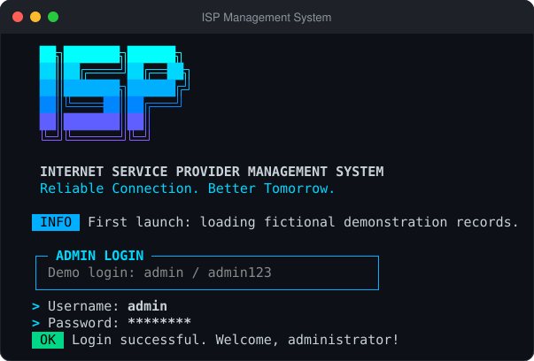
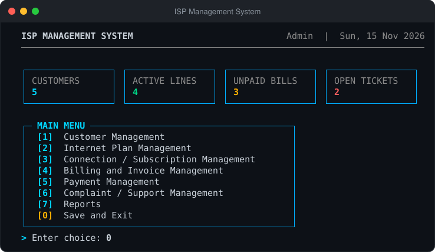
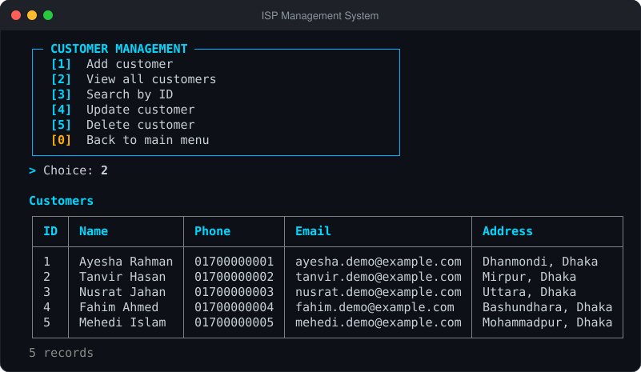
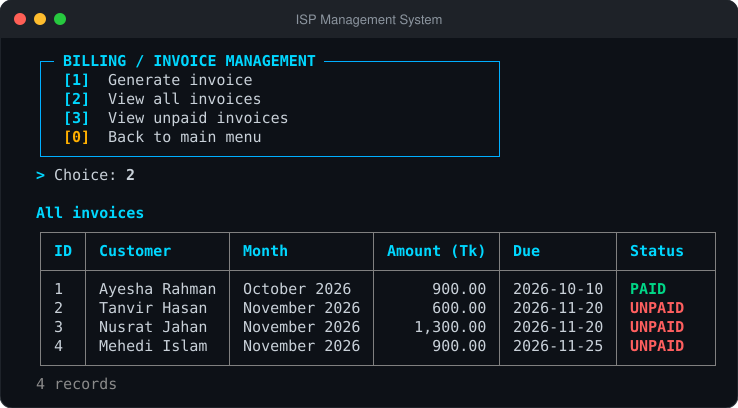
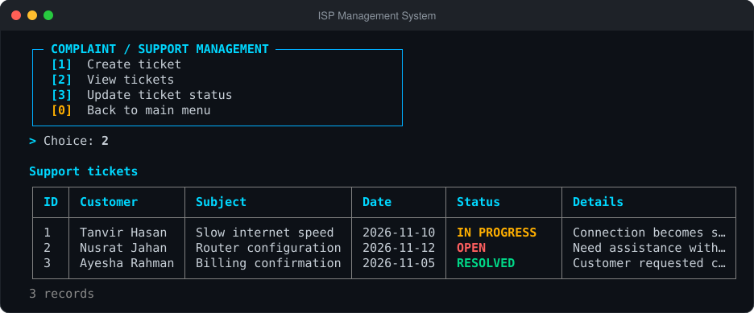
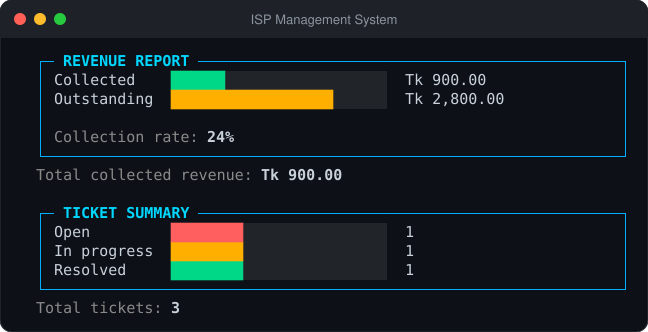

# ISP Management System

A menu-driven **Internet Service Provider (ISP) Management System** written in **Core Java**. It runs in the terminal, but with a colourful interface: a dashboard, boxed tables, coloured status labels, bar charts and a small start-up animation.





## Features

| Module | Functions |
|---|---|
| Admin access | Administrator login with a hidden password |
| Customers | Add, list, search, update and delete customers |
| Internet plans | Add, list, update and delete plans |
| Connections | Create subscriptions (one active connection per customer), list connections, activate/deactivate |
| Billing | Generate monthly invoices, list all and unpaid invoices |
| Payments | Record full invoice payments and update the invoice status |
| Support | Create tickets, list tickets, update ticket status |
| Reports | Customer list, active connections, revenue with collection rate, outstanding bills, ticket summary |
| Data storage | Save and load data using Java object serialization |
| Interface | Dashboard cards, boxed tables, status colours, bar charts, start-up animation |

## More screens

| | |
|---|---|
|  |  |
|  |  |

## Technology

- Java (JDK 8 or later)
- Object-oriented programming (classes and objects)
- `ArrayList` collections and streams
- Methods, loops, conditionals and input validation
- File handling and Java serialization
- ANSI colours and Unicode box characters for the interface
- No external libraries or database

## Quick start

### 1. Download or clone

```bash
git clone https://github.com/Sadat00-ai/isp-management-system.git
cd isp-management-system
```

Or download the ZIP and extract it.

### 2. Compile

```bash
javac -encoding UTF-8 -d out src/isp/*.java
```

### 3. Run

```bash
java -cp out isp.Main
```

On Windows you can also double-click `run.bat`.

### Default demo login

| Username | Password |
|---|---|
| `admin` | `admin123` |

> This is a demonstration login, not real security. Change it before using the program for anything real.

## Colours and terminals

The program checks your terminal when it starts.

- On macOS and Linux terminals, colours and box drawing turn on automatically.
- On Windows, start it with `run.bat` (it switches the console to UTF-8) in Windows Terminal or the VS Code terminal. If you start Java yourself, run `chcp 65001` first.
- Older Windows `cmd` windows and some IDE consoles can't show colours, so the program switches to a plain ASCII layout that still has tables and menus.
- The start-up animation only plays in a real terminal.

You can choose yourself with these options:

```bash
java -cp out isp.Main --plain      # no colours, ASCII only
java -cp out isp.Main --fancy      # force colours and box drawing
java -cp out isp.Main --no-anim    # skip the start-up animation
```

If you see strange characters like `←[36m` on screen, run it with `--plain`. For the best look, use a terminal that is at least 100 columns wide.

## Demo data

On the first run the program loads fictional sample records so you can try every module straight away:

- 5 demo customers
- 4 internet packages
- 5 subscriptions (4 active, 1 inactive)
- 4 invoices (1 paid, 3 unpaid)
- 1 recorded payment
- 3 support tickets

All names, phone numbers, email addresses, addresses and transactions are made up.

When you exit, the program saves everything to `isp-data.ser` in the folder you started it from, and loads that file next time. To get the original demo data back, close the program and delete `isp-data.ser`.

## Project structure

```text
isp-management-system/
├── .github/
│   └── workflows/
│       └── java-build.yml
├── assets/
│   └── (screenshots used in this README)
├── src/
│   └── isp/
│       ├── Main.java
│       ├── ISPManagementSystem.java
│       ├── Ui.java
│       ├── InputUtil.java
│       ├── DataStore.java
│       ├── SampleData.java
│       ├── AppData.java
│       ├── Customer.java
│       ├── InternetPlan.java
│       ├── Subscription.java
│       ├── Invoice.java
│       ├── Payment.java
│       └── SupportTicket.java
├── .gitignore
├── LICENSE
├── README.md
└── run.bat
```

`Ui.java` draws everything on screen (colours, boxes, tables, bars). `ISPManagementSystem.java` holds the menus and the program logic.

## Run online

This is a **console application**, not a website, so there is no public page to open. You can run it in an online Java environment that has a terminal.

**GitHub Codespaces:** open this repository on GitHub, select **Code → Codespaces → Create codespace**, then run the compile and run commands above in the terminal. See GitHub's guide: [Set up a Java project in GitHub Codespaces](https://docs.github.com/en/codespaces/setting-up-your-project-for-codespaces/adding-a-dev-container-configuration/setting-up-your-java-project-for-codespaces).

**Replit:** [Replit](https://replit.com/import) can import repositories from GitHub. Import this one and run the Java project from its console.

## Limits of this project

This is a student project, not a real ISP platform.

- The login uses a fixed username and password.
- Data is stored in a local file, not a database.
- Invoices are created by hand, not on a schedule.
- Payments are full payments only. Partial payments and refunds are not included.
- There is no router control, customer portal, SMS, email or payment gateway.
- Dates are typed as text, so use one format such as `YYYY-MM-DD`.

A real system would also need hashed passwords, user roles, a database, backups, audit logs and stronger input checks.

## License

Released under the MIT License. See [LICENSE](LICENSE).
